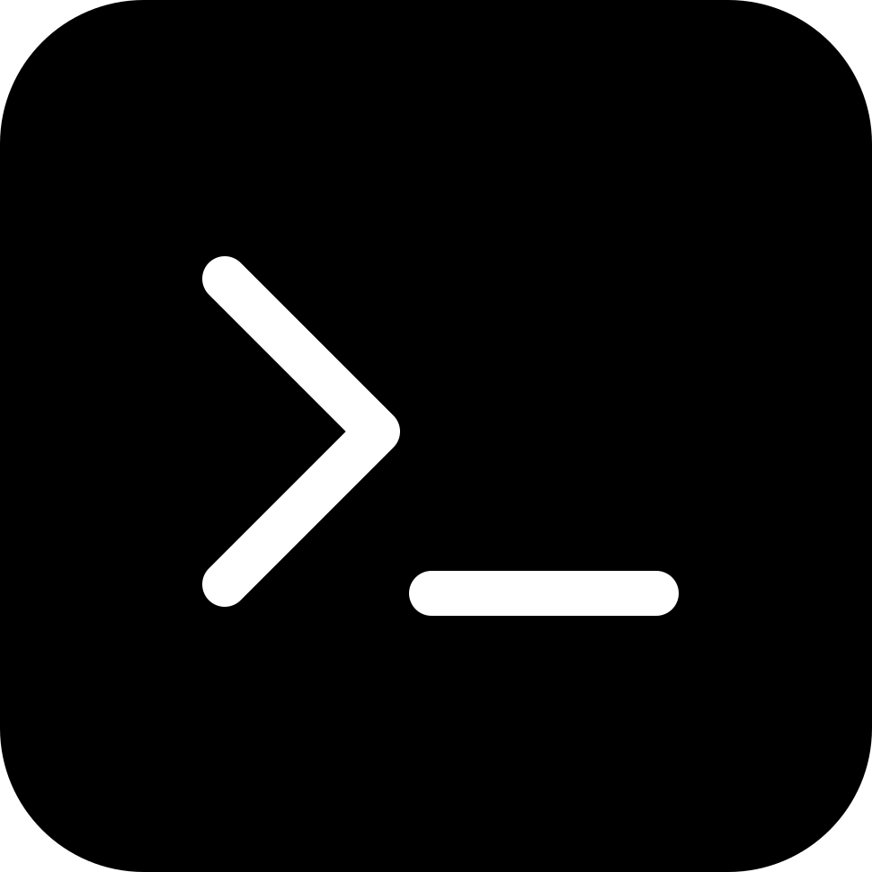

<div align="center">
  
  <h1>gray-inline-bash</h1>
  <p><strong>Run shell commands inline with !cmd or $ cmd, without a model turn.</strong></p>
  <p>
    <a href="https://gray.alignment.id">Website</a> ·
    <a href="https://gray.alignment.id/plugins/gray-inline-bash">Store</a> ·
    <a href="https://github.com/vstaln/gray-inline-bash">Source</a> ·
    <a href="https://github.com/vstaln/gray">gray</a>
  </p>
  <p>
    <a href="LICENSE"></a>
    <a href="https://www.rust-lang.org"></a>
    <a href="https://gray.alignment.id/plugins/gray-inline-bash"></a>
  </p>
</div>

<br/>

```bash
gray plugin install gray-inline-bash
```

Run shell commands inline — `!cmd` or `$ cmd` — and see the output without a
model turn.

A sidecar plugin for [gray](https://github.com/vstaln/gray).

## What it does

Hooks `input/submit` (protocol 2.0):

| input | effect |
|---|---|
| `!cmd` / `!{cmd}` / `$ cmd` | runs `timeout 10 sh -c "cmd"` in the session cwd, `host/say`s the output (4 KB cap), input swallowed |
| anything else | passes through unchanged |

If `host/say` fails (capability ungranted) the input is rewritten to
`The user ran `<cmd>` and saw: …` instead — a visible turn beats a silent
swallow. Non-zero exit codes are shown as `(exit N)`.

`/inline` reports status; `/inline on|off` toggles (state in
`~/.gray/inline-bash/`).

## Wire methods

- `plugin/manifest`, `plugin/shutdown`
- `input/submit` — `{handled:true}` swallow / `{text}` fallback rewrite / `{}` pass
- `command/run` — `/inline`, `/inline on|off`
- sidecar→host `host/say` — capability `host.say`

## Install / consent

```sh
gray plugin install inline-bash
gray plugin capabilities inline-bash --all   # grants host.say
```

## Develop

```sh
cargo test
gray account check      # entry point + manifest handshake
gray account publish    # check → build → release → publish to the gray registry
```

Bump `version` in `Cargo.toml` before each `publish`; the registry refuses to
republish a version.

## Tags

`gray` `plugin` `inline-bash` `rust`

---

Part of the [gray](https://github.com/vstaln/gray) plugin ecosystem —
the open-source AI agent harness. <https://gray.alignment.id>
